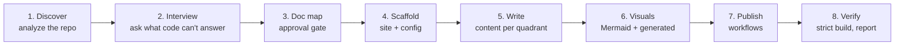

# document-it

[](https://skills.sh/wushanyun64/document-it/document-it)

An agent skill that builds **clear, publishable documentation for a code repository** and keeps
it in sync with the code.

Point your coding agent at a repo and say *"document this project"*. The skill interviews you
about readers and scope, analyzes the codebase, and writes a structured doc set with diagrams.
It then publishes the docs as a [Zensical](https://zensical.org/) site on GitHub Pages and sets
up CI so the docs keep up with the code.

## What you get

- **A structured doc set** that follows [Diátaxis](https://diataxis.fr/): tutorials,
  how-to guides, reference, and explanation, each with its own page template and writing rules.
- **Diagrams.** Hand-written [Mermaid](https://mermaid.js.org/) diagrams for architecture and
  flows, plus dependency and class diagrams generated from the code at build time.
- **API reference generated from your docstrings** (Python) via mkdocstrings. Signatures are
  never copied by hand, so they can't go stale.
- **GitHub Pages publishing.** A deploy workflow builds and publishes the site on every push.
- **Docs that keep up with the code:**
  - Generated pages (API, diagrams, CLI help) rebuild on every deploy.
  - Pull requests are checked for broken links, broken code examples, and public API changes
    that weren't documented.
  - Optionally, an AI agent in CI opens a pull request that updates the hand-written pages when source
    code changes.

## Install

With the [Skills CLI](https://skills.sh/):

```bash
npx skills add wushanyun64/document-it
```

The CLI detects your agents and installs the skill for each of them (Claude Code, Codex, Cursor,
GitHub Copilot, Gemini CLI, Cline, and others). Add `-g` to install it for all your projects
instead of the current one.

Or copy the skill folder into your agent's skills directory manually, for example:

```bash
git clone https://github.com/wushanyun64/document-it.git
cp -r document-it/skills/document-it ~/.claude/skills/   # Claude Code, all projects
cp -r document-it/skills/document-it <repo>/.agents/skills/  # agents that read .agents/skills
```

Check your agent's docs for its skills directory. The skill uses the open `SKILL.md` format and
plain Python scripts, so it works with any agent that supports skills and can run shell commands.
Some agents also expose it as a command (in Claude Code: `/document-it`).

## Usage

Open your agent in the repository you want to document and ask, for example:

- "Document this repo."
- "Set up a docs site for this project and publish it to GitHub Pages."
- "Our docs are out of date. Restructure them and keep them in sync with the code."
- "Update the docs for the changes since the last release."

## How it works



1. **Discover.** The agent reads the repo first (packaging, public API, CLIs, examples, existing
   docs), so it never asks you something the code already answers.
2. **Interview.** It asks a few questions in batches, each with a recommended default:
   who the readers are, what's in scope, publishing options, and how automated updates should be.
   Your answers go in `docs/.doc-spec.yml`.
3. **Doc map.** It proposes every page, diagram, and nav entry, and writes nothing until you approve.
4. **Steps 4–8.** It builds the site, writes the content, adds the workflows, runs a strict build,
   and reports what passed, what failed, and the manual steps left for you.

## What it adds to your repo

```
your-repo/
├── zensical.toml                  # site config
├── requirements-docs.txt          # pinned docs toolchain
├── docs/
│   ├── .doc-spec.yml              # your interview answers: audience, scope, tone
│   ├── index.md
│   ├── tutorials/  how-to/  reference/  explanation/
│   └── reference/diagrams.md      # generated at build time
├── tools/docs/
│   ├── gen_diagrams.py            # import graph + class hierarchy from code
│   └── check_drift.py             # flags code changes without doc changes
├── tests/test_docs.py             # runs the Python examples in your docs
└── .github/workflows/
    ├── docs-deploy.yml            # build + deploy to GitHub Pages
    ├── docs-check.yml             # PR checks
    └── docs-ai-update.yml         # optional: an AI agent proposes doc PRs
```

After the skill finishes, you still need to do a few things yourself:

- Set **Settings → Pages → Source** to **GitHub Actions**.
- For AI doc updates only:
  - Add the agent's API key as a repository secret (`ANTHROPIC_API_KEY` for the default,
    Claude Code Action; the workflow documents how to swap in another agent).
  - Allow GitHub Actions to create pull requests.

## Requirements

- **Your agent:** any agent that supports `SKILL.md` skills and can read files and run shell
  commands. Its environment needs Python 3.10+ and git.
- **Your project:** the docs are built with Zensical, installed from `requirements-docs.txt`.
- **Optional:** [Graphviz](https://graphviz.org/) for SVG diagrams. Without it, the generated
  diagrams use Mermaid instead. The CI workflows install it automatically.

## Limitations

- **API reference generation is Python-only.** For other languages, the skill plans
  tool-exported reference (TypeDoc, gomarkdoc, OpenAPI) or a hand-written one.
- **Versioned docs don't use Zensical.** The versioning tool (`mike`) doesn't support Zensical yet,
  so versioned docs use a fallback stack: ProperDocs, Material for MkDocs, and mike. Material is
  in maintenance mode, and the skill tells you about this trade-off when you choose versioned docs.
- **AI doc updates read contributor-written code.** The optional AI workflow is hardened against
  prompt injection: the agent job is read-only, a guard allows changes only under `docs/`, and a
  separate non-agent job opens a PR for human review. Skip it for repos with unreviewed outside contributions.
- **Tested with Claude Code.** The skill avoids agent-specific features (questions fall back to plain
  chat), but other agents haven't been tested yet. Reports are welcome.
- **Publishing targets GitHub.** The workflows are GitHub Actions and the site is hosted on GitHub Pages.
- **Built-in diagrams cover Python only.** The import graph and class hierarchy come from Python
  source. Other languages can plug in their own diagram tools.

## Repository layout

```
skills/document-it/
├── SKILL.md          # the workflow the agent follows
├── references/       # detail loaded per phase: interview, writing, visuals, setup, publishing, sync
├── scripts/          # analyze_repo.py, gen_diagrams.py, check_drift.py (standard library only, no network)
└── templates/        # zensical.toml, docs skeleton, page templates, workflows, tests, versioned-docs fallback
```

## Contributing

Issues and pull requests are welcome. If you change the templates, check that a scaffolded repo
still builds:

```bash
pip install -r skills/document-it/templates/requirements-docs.txt
# scaffold into a sample repo following SKILL.md, Phase 4, then:
zensical build --clean --strict
```

## License

[MIT](LICENSE)
