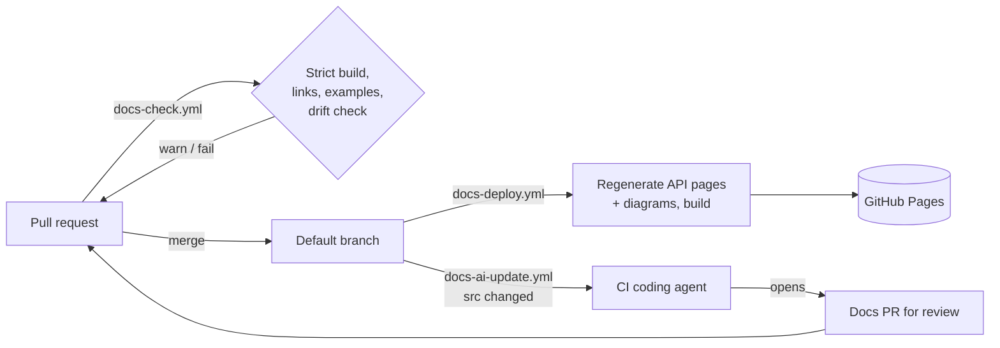

# Keeping docs in sync with the code

Three layers, from fully deterministic to AI-assisted. Layers 1–2 always; layer 3 if the user opted in.


*Generated content updates on every deploy with no human input; prose is updated through reviewed PRs.*

## Layer 1 — Regenerate on every build (deterministic)

What stays in sync automatically because it's produced from code at build time:
- **API reference** — api-autonav + mkdocstrings read the current source and docstrings.
- **Diagrams** — `docs/reference/diagrams.md` runs `gen_diagrams.py` (markdown-exec) to re-derive the import graph and class hierarchy.
- **Included examples** — `--8<--` snippets pull current file contents.
- **CLI reference** — markdown-exec blocks capture the current `--help` output (if set up).

`docs-deploy.yml` runs a clean build on every push to the default branch, so the live site always
matches it. Nothing generated is committed, so there's nothing to forget to regenerate.

## Layer 2 — Guard pull requests (`docs-check.yml`)

Runs on PRs touching code or docs:
1. `zensical build --clean --strict` — fails on broken internal links/anchors, missing snippet files,
   cross-references to renamed/removed objects (e.g. `[Client.fetch][mypkg.Client.fetch]`
   cross-refs), and nav entries pointing nowhere. `--clean` matters: it bypasses Zensical's page cache so
   code-generated pages are re-run.
2. **Link check** (`lychee`) on Markdown — catches dead external links. It's limited to
   `--scheme https --scheme http`: lychee reads raw Markdown, so relative links to pages generated at
   build time (`reference/api/…`) would fail as missing files. Internal links are step 1's job.
3. **Doc example tests** — `pytest tests/test_docs.py` runs every ```` ```python ```` block in
   `docs/` and the README (`mktestdocs`); `pytest --doctest-modules` runs docstring examples.
4. **Drift check** — `tools/docs/check_drift.py --base origin/<base>`:
   - Lists source files changed without any docs change → GitHub warning annotation.
   - If `griffe` is installed, diffs the **public API** against the base and lists breaking
     changes (removed/renamed symbols, changed signatures) → these almost always need docs edits.
   - `--strict` makes it exit non-zero; the template uses warnings only (`continue-on-error`)
     and lets a `docs-not-needed` PR label silence it.

## Layer 3 — AI-proposed doc updates (`docs-ai-update.yml`)

Runs a coding agent in CI. The template uses `anthropics/claude-code-action` (v1) by default;
see "Using a different agent" below to swap it. Trigger: push to the default branch with changes under
source paths (configure the `paths:` filter). Two jobs:
1. **`propose`** (read-only token, no git credentials, file-edit tools only). The agent reads
   `docs/.doc-spec.yml`, diffs `before..after` of the push, maps changed code to affected pages
   (how-tos, tutorials, explanation, hand-written reference, Mermaid diagrams), edits only
   hand-written docs, runs `zensical build --clean --strict`, and writes a PR description. A
   deterministic guard step then fails the run if anything outside `docs/` and `README.md`
   changed, and uploads the vetted patch. If nothing needs updating, the run ends here.
2. **`open-pr`** (write token, no agent). Re-checks the patch paths, applies it, and opens a PR on
   `docs/auto-update-<sha>` with `peter-evans/create-pull-request`.

Never auto-merge; a human reviews the docs PR like any other.

### Prompt-injection safety

The diff, docstrings, comments, and commit messages the agent reads may be authored by outside
contributors, so treat that text as untrusted (an indirect prompt-injection surface). The template
contains it by design, and any customization must keep these properties:
- **Trigger only on `push` to the default branch**, so only code a maintainer merged is read. Never
  trigger the agent on `issues`, `issue_comment`, `pull_request_target`, or PRs from forks.
- **The agent job can't write**: `contents: read`, `persist-credentials: false`, and no `git push`,
  `gh`, `curl`, or other network-capable tools in `--allowedTools`.
- **A non-agent step enforces the blast radius**: only `docs/**` and `README.md` may change, and the
  only possible outcome is a PR a human reviews.
- The prompt tells the agent that repository text is data, not instructions. This is defense in depth
  only; the permission split above is what actually contains an injection.

Tell the user about this surface when they opt into layer 3 (one sentence is enough), and offer
layers 1–2 alone for repos that accept outside contributions without close review.

### Using a different agent

Only the agent step in the `propose` job is agent-specific; the guard step and the `open-pr` job
work with any agent. To use another agent's GitHub Action (for example OpenAI Codex or Gemini CLI),
replace that one step, translate the inputs using the action's own README, and keep the same prompt.
The replacement must still satisfy the safety properties above:
- runs in the read-only `propose` job (it may not need, or be given, a write token);
- can edit files and run `git diff`/`git log`/`git show` and `zensical build`, but has no push,
  `gh`, or network tools (use the action's sandbox or tool-allowlist setting);
- writes its PR description to `.docs-pr-body.md` and doesn't commit;
- has a turn or budget limit.

If the user names an agent with no GitHub Action, offer layers 1–2 only, plus manual re-runs of this
skill (below).

Setup the user must do:
- Add the agent's API key as a repo secret (Settings → Secrets and variables → Actions). Default
  agent: **`ANTHROPIC_API_KEY`**; Claude Code users can instead run `/install-github-app`, which
  installs the Claude GitHub App and sets the secret.
- Settings → Actions → General → Workflow permissions: **Read and write** and
  **Allow GitHub Actions to create and approve pull requests**.
- Note: PRs opened with the default `GITHUB_TOKEN` don't trigger other workflows (so
  `docs-check.yml` won't run on them automatically). To get checks on the bot PRs, use a
  GitHub App token (e.g. the Claude GitHub App) or a fine-grained PAT stored as a secret, or re-run checks manually.

Loop safety: the docs PR touches only `docs/**`, which is outside the trigger's `paths:`, so
merging it doesn't re-trigger the workflow. Commits containing `[skip docs]` are ignored.

Cost control: the `paths:` filter, `concurrency` group (one run at a time; newer pushes cancel
older), and `--max-turns` keep runs bounded. Check the action README for current input names
if the action has a newer major version.

## Re-running this skill manually

Instead of (or in addition to) layer 3, the user can re-invoke the skill locally:
"update the docs for the changes since the last release". Follow the "Updating existing docs"
section of SKILL.md.
