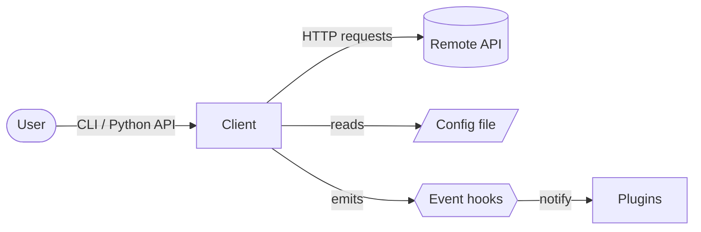
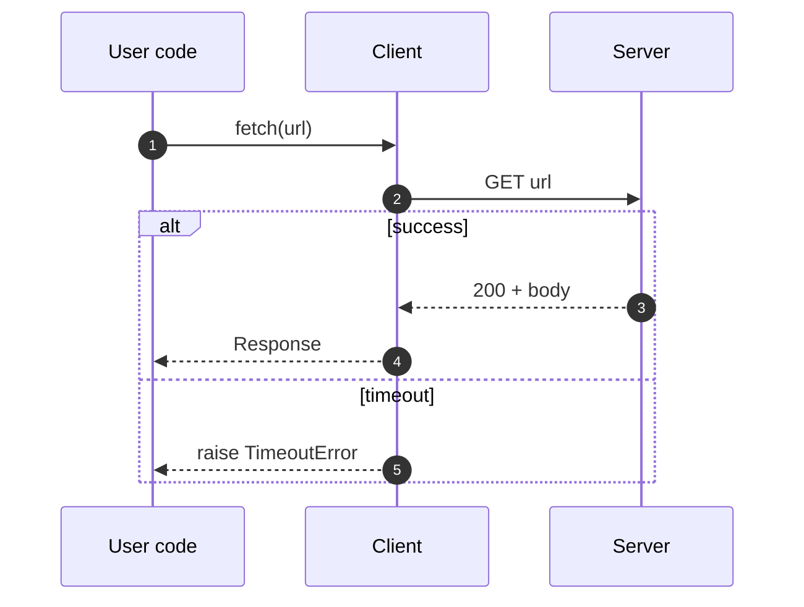
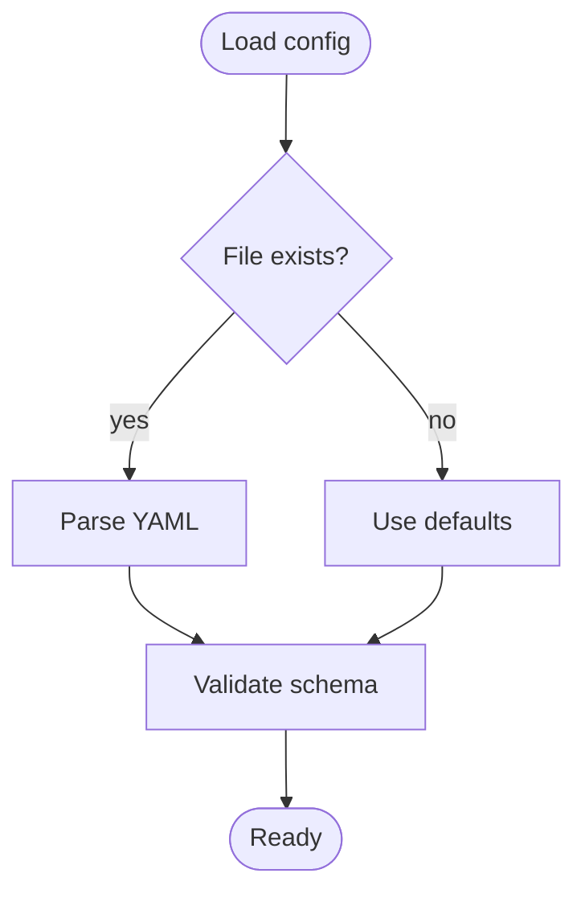
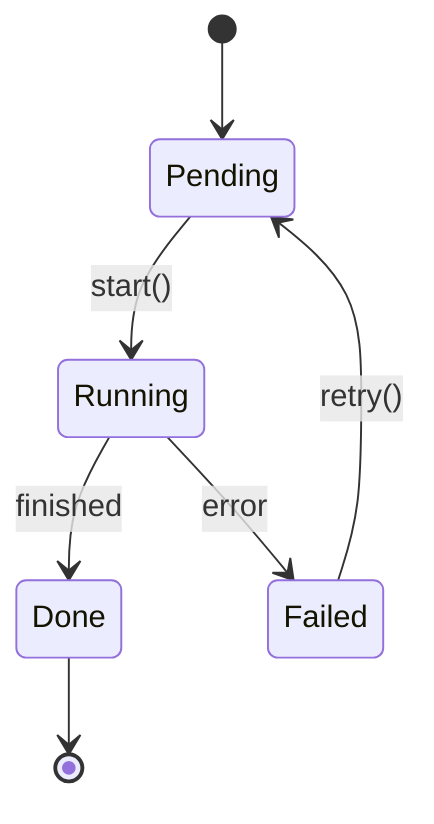
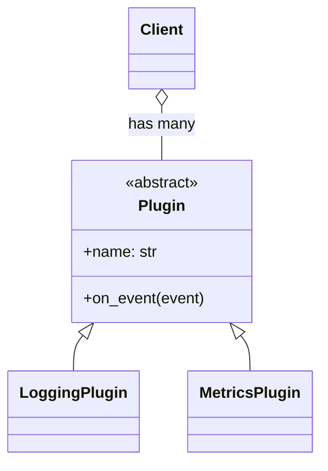
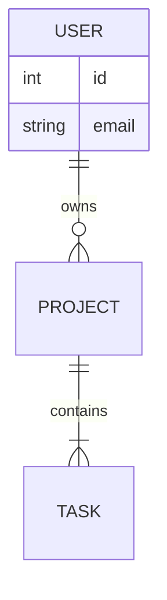

# Visuals

Two kinds, with different lifecycles:

| Kind | Source of truth | Who updates it | Use for |
|---|---|---|---|
| **Mermaid** (hand-authored) | Fenced block inside the Markdown page | Author / AI update PR, reviewed like prose | Concepts, architecture, flows, lifecycles — the *intended* design |
| **Generated** (from code) | The code itself, rendered at build time | Nobody — regenerated on every build | Module dependencies, class hierarchy — the *actual* structure |

Both render on GitHub Pages; Mermaid also renders in GitHub's Markdown viewer.

## When a diagram earns its place

Add one when the reader must hold **relationships** in their head: components and how they
talk, a multi-step flow with branches, a lifecycle with states, a data model. Skip it when a
list or table says the same thing.

Placement:
- **Explanation landing / architecture page:** one overview diagram (mandatory for non-trivial projects).
- **Explanation topic pages:** sequence or flow diagram of the mechanism discussed.
- **How-to guides:** only for tasks with a non-obvious flow (e.g., OAuth dance) — small.
- **Tutorials:** rarely; maybe one "what you'll build" picture.
- **Reference:** the generated `reference/diagrams.md` page (import graph, class hierarchy); ER diagram for data models.

## Rules

- ≤ ~15 nodes per diagram; split into overview + zoom-ins if bigger.
- Label every edge with the verb ("calls", "publishes", "reads").
- Use the same names as the code and the prose (terminology from `.doc-spec.yml`).
- Direction: `LR` for pipelines/flows, `TB` for hierarchies.
- Caption directly below: *one sentence telling the reader what to notice.*
- Don't hard-code colors (they break dark mode); use `classDef` sparingly for emphasis only.
- Wrap node labels with special characters in quotes: `A["Client (sync)"]`.

## Mermaid catalog

Enabled in `zensical.toml` via the `pymdownx.superfences` custom fence (already in the template).

### Architecture / component overview

````markdown

*The `Client` is the only component that talks to the network; plugins observe it through events.*
````

Shapes: `[rect]` component, `([stadium])` actor, `[(cylinder)]` datastore, `[/parallelogram/]` file/input, `{{hexagon}}` event/queue, `{diamond}` decision.
Group with `subgraph Core [Core library] ... end`.

### Sequence (request lifecycle, protocols)

````markdown

````

### Flowchart (decision logic, pipelines)

````markdown

````

### State (lifecycles)

````markdown

````

### Class (key abstractions — hand-picked, not every class)

````markdown

````

### Entity-relationship (data models)

````markdown

````

### Timeline / Gantt — for release or migration explanations only.

## Generated diagrams

`tools/docs/gen_diagrams.py` (copied from `$SKILL/scripts/`) statically analyzes Python
packages with `ast` (no imports executed) and produces:
- **Import graph** — which internal modules import which (per top-level package).
- **Class hierarchy** — internal base → subclass relationships.

It runs **inside the docs build**: `docs/reference/diagrams.md` contains a two-line
```` ```python exec="on" ```` block (markdown-exec) that calls `gen_diagrams.render_from_env()`.
The output is never committed and never stale (build with `--clean`; see `site-setup.md`).
- If Graphviz `dot` is on PATH → embeds **inline SVG** (CI installs `graphviz` via apt).
- Otherwise → falls back to **Mermaid** blocks in the same page, so the build never breaks.

Standalone use (e.g. to preview or to commit an image for the README):

```bash
python3 tools/docs/gen_diagrams.py --src src --out /tmp/diagrams --format svg   # or dot, mermaid
```

Tuning (env vars read at build time): `DOCS_SRC` (source root), `DOCS_PACKAGES`,
`DOCS_DIAGRAM_MAX_NODES` (default 40; larger graphs collapse to package level). To disable,
remove the page from the nav and delete it.

Non-Python projects: write a small script that emits Mermaid or DOT for the language
(e.g. `madge --image` for JS/TS, `cargo modules` for Rust, `go mod graph`) and call it from a
markdown-exec block the same way, or add a CI step before `zensical build`.

## Images and screenshots

- Store in `docs/assets/images/`, SVG for diagrams, PNG/WebP for screenshots (≤ 200 KB).
- Always alt text: ``.
- Screenshots go stale; prefer them only for UI that changes rarely, and note the version.
