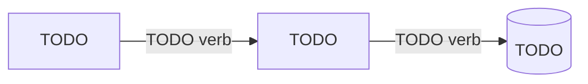

# About TODO

TODO: one paragraph — what this page discusses and why it matters to the reader.

## Overview

*TODO: one sentence telling the reader what to notice.*

## How it works

TODO: discuss the mechanism; refer to the components in the diagram by the same names.

## Design decisions and trade-offs

TODO: why it's built this way, what alternatives were considered, what it costs.

## Related

- [TODO reference](../reference/TODO.md)
- [How to TODO](../how-to/TODO.md)
